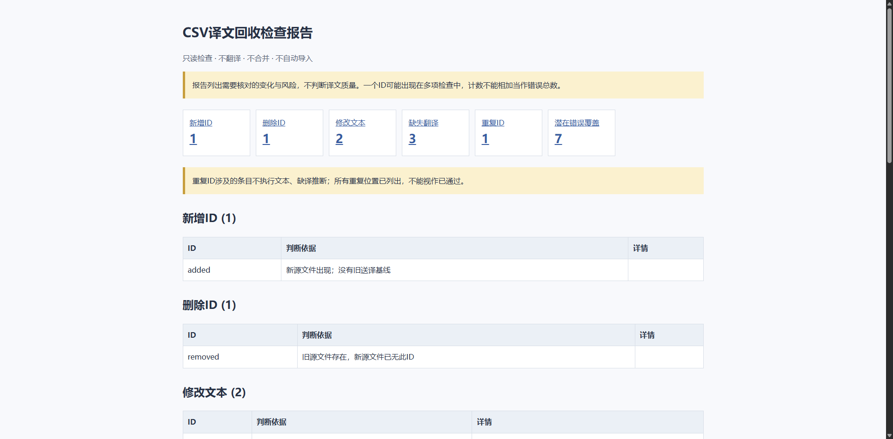
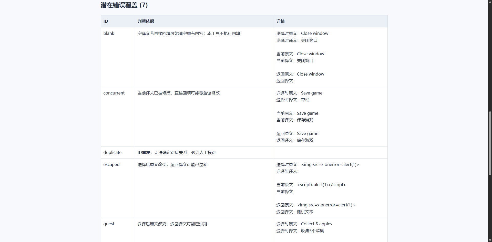

# Two-minute demo / 两分钟演示

This demonstration uses only synthetic text. It does not represent customer feedback or saved work time.
报告为中文；标签英文解释见 README。

1. Open `examples/old_source.csv`, `new_source.csv` and `returned_translation.csv` in a text editor (not required to use Excel).
2. Find **quest**: the source changed from “Collect 5 apples” to “Collect 10 apples”, while the returned file still carries the five-apple source.
3. Run the command in README, or open `demo_report.html`.
4. Click **潜在错误覆盖** (potential overwrite risk). Find **quest**. The report flags the stale return; it does not decide the correct translation.
5. Find **concurrent**: current target text changed from “存档” to “保存游戏”; the returned target is “储存游戏”. Direct replacement could erase the current edit.
6. Check **重复ID**: the sample repeats `duplicate` in the old snapshot. The report refuses to pick a winner.
7. Confirm input files remain unchanged. Only the new HTML file was written.

Expected synthetic counts:

| Check | Count |
|---|---:|
| Added IDs / 新增ID | 1 |
| Deleted IDs / 删除ID | 1 |
| Changed source / 修改文本 | 2 |
| Missing returned translation / 缺失翻译 | 3 |
| Duplicate-ID groups / 重复ID | 1 |
| Potential overwrite entries / 潜在错误覆盖 | 7 |

Counts overlap. The intentionally embedded HTML-like text tests escaping and should appear as plain text.
`unicode` checks multiline Chinese and quotes; it is not a translation-quality test.

### Optional 45-second screen-recording script (not recorded yet)

0–10s: show the two quest source values.
10–20s: show the returned old source and the command.
20–35s: open report, click risk, show quest and concurrent.
35–45s: explain “local report only; no file changes, no translation or automatic import”.

The supplied static report and screenshots are the actual demo artifacts; no video recording is claimed.

